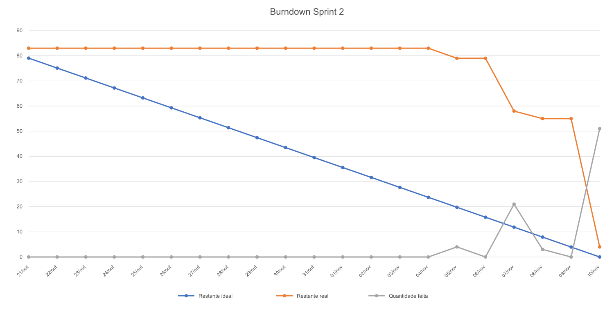

# Sprint 2

**Período:** 21/10/2026 a 10/11/2026

## 🎯 Objetivo da Sprint

Entregar o núcleo funcional do Green-Byte, evoluindo a fundação construída na Sprint 1 para uma aplicação capaz de coletar, persistir, calcular e apresentar indicadores ambientais de maneira integrada. O foco da Sprint 2 foi consolidar as regras de cálculo de energia e emissão de CO₂e, o histórico de coletas, os estados dos serviços, a tolerância a falhas, os endpoints analíticos e a integração dessas informações ao dashboard.

Também foram incorporadas entregas inicialmente previstas para a Sprint 3, como os gráficos históricos, a comparação entre serviços e a autenticação com JWT. Essa antecipação ampliou o escopo efetivamente entregue e deixou para a última sprint principalmente a área de configuração, responsividade, avaliação de usabilidade e revisão final de qualidade e documentação.

---

## Backlog Sprint 2 — Regras de domínio, histórico, dashboard e autenticação

> Objetivo: disponibilizar um fluxo completo entre coleta, persistência, cálculo, API e interface, mantendo o sistema operante mesmo diante de dados ausentes ou indisponibilidade parcial das APIs externas.

**Total planejado: 83 pts**  
**Issues técnicas e funcionais fechadas: 79 pts**  
**Pontos administrativos ainda abertos no Project ao final de 10/11: 4 pts (GA-11 e GA-12)**

| Issue | ID | Atividade | Pontos | Área | Requisito |
|---:|---|---|:---:|---|---|
| [#21](https://github.com/KaimanByte/Green-Byte/issues/21) | GA-10 | Planejamento da Sprint 2 | 2 | Gestão | RP08 |
| [#22](https://github.com/KaimanByte/Green-Byte/issues/22) | GA-11 | Sprint Review e Retrospectiva da Sprint 2 | 2 | Gestão | RP08 |
| [#23](https://github.com/KaimanByte/Green-Byte/issues/23) | GA-12 | Fechamento e entrega da Sprint 2 | 2 | Gestão | RP08 |
| [#37](https://github.com/KaimanByte/Green-Byte/issues/37) | IT-06 | Agendar a coleta periódica com intervalo configurável | 3 | Backend | RF03, RNF03 |
| [#41](https://github.com/KaimanByte/Green-Byte/issues/41) | DB-04 | Histórico de coletas com consulta por período | 5 | Banco de Dados | RF10 |
| [#42](https://github.com/KaimanByte/Green-Byte/issues/42) | CA-01 | Calcular potência a partir de CPU, RAM, disco e rede | 5 | Backend | RF07, RP04, RNF07 |
| [#43](https://github.com/KaimanByte/Green-Byte/issues/43) | CA-02 | Calcular energia e emissão de CO₂e | 3 | Backend | RF07 |
| [#44](https://github.com/KaimanByte/Green-Byte/issues/44) | CA-03 | Tratar dados ausentes ou inválidos no cálculo | 2 | Backend | RF06, RNF05, RNF07 |
| [#45](https://github.com/KaimanByte/Green-Byte/issues/45) | CA-04 | Calcular indicadores agregados do ambiente | 3 | Backend | RF08 |
| [#47](https://github.com/KaimanByte/Green-Byte/issues/47) | MD-01 | Classificar o estado de cada serviço | 5 | Backend | RF05, RF06, RNF07 |
| [#48](https://github.com/KaimanByte/Green-Byte/issues/48) | MD-02 | Reconciliar a lista de serviços a cada ciclo | 5 | Backend | RF02 |
| [#49](https://github.com/KaimanByte/Green-Byte/issues/49) | MD-03 | Garantir tolerância a falhas das APIs auxiliares | 3 | Backend | RNF05 |
| [#50](https://github.com/KaimanByte/Green-Byte/issues/50) | MD-04 | Testes unitários de estados e reconciliação | 3 | Qualidade | RNF07 |
| [#52](https://github.com/KaimanByte/Green-Byte/issues/52) | API-02 | Validação de entrada e tratamento global de exceções | 3 | Backend | RP02, RNF06 |
| [#53](https://github.com/KaimanByte/Green-Byte/issues/53) | API-03 | Endpoints de histórico e indicadores | 5 | Backend | RF08, RF10 |
| [#55](https://github.com/KaimanByte/Green-Byte/issues/55) | API-05 | Endpoints de ranking e comparação | 5 | Backend | RF14, RF15 |
| [#61](https://github.com/KaimanByte/Green-Byte/issues/61) | FE-06 | Estados e alertas por texto e ícone | 2 | Frontend | RNF02 |
| [#62](https://github.com/KaimanByte/Green-Byte/issues/62) | FE-07 | Estados de carregamento, vazio e erro | 3 | Frontend | RNF05, RNF01 |
| [#63](https://github.com/KaimanByte/Green-Byte/issues/63) | FE-08 | Gráfico de histórico por serviço | 5 | Frontend | RF10 |
| [#65](https://github.com/KaimanByte/Green-Byte/issues/65) | FE-10 | Comparação entre serviços | 5 | Frontend | RF15 |
| [#68](https://github.com/KaimanByte/Green-Byte/issues/68) | AU-01 | Login com senha em hash e emissão de JWT | 5 | Backend | RF16, RP07, RNF06 |
| [#69](https://github.com/KaimanByte/Green-Byte/issues/69) | AU-02 | Proteger rotas de configuração com JWT | 3 | Backend | RF16, RP07, RNF06 |
| [#72](https://github.com/KaimanByte/Green-Byte/issues/72) | AU-05 | Usuário inicial por seed e variáveis de ambiente | 2 | Backend | RNF06 |
| [#76](https://github.com/KaimanByte/Green-Byte/issues/76) | UX-07 | Animação de abertura na inicialização | 2 | Interface | RP09, RNF01 |

---

## Sprint Burndown

O gráfico utiliza as datas de fechamento registradas nas issues do GitHub. A linha ideal considera uma redução uniforme dos 83 pontos entre 21/10 e 10/11. A linha real permaneceu em 83 pontos até 04/11, caiu para 79 pontos em 05/11, chegou a 58 em 07/11, a 55 em 08/11 e encerrou 10/11 com 4 pontos ainda registrados como abertos.

A concentração da baixa de pontos na parte final não significa necessariamente que todo o desenvolvimento ocorreu nesses dias. Ela demonstra, sobretudo, que a atualização e o fechamento das issues no Project aconteceram de forma tardia. Para fins de rastreabilidade, o burndown representa o que foi efetivamente registrado no GitHub, e não uma reconstrução subjetiva da data em que cada trecho de código começou ou terminou.

---

## 🔄 Retrospectiva da Sprint 2

A Sprint 2 apresentou uma evolução técnica significativa. A equipe conseguiu transformar a base construída na sprint anterior em um sistema com regras de negócio próprias, histórico, indicadores agregados, estados monitoráveis e recursos analíticos no frontend. A antecipação de itens inicialmente planejados para a Sprint 3 demonstra capacidade de execução e reduz parte do risco funcional do encerramento do projeto.

Um aspecto positivo foi a divisão das responsabilidades do backend em componentes menores. Clients concentram o acesso às APIs externas, repositories tratam a persistência e services organizam as regras de negócio. Essa estrutura tornou os testes mais representativos e diminuiu o acoplamento entre rede, banco e cálculo. No frontend, a centralização das chamadas e o tratamento independente dos estados de cada painel melhoraram a tolerância a falhas e a previsibilidade da interface.

O principal ponto de melhoria está no acompanhamento do trabalho. O burndown permaneceu praticamente estático durante grande parte do período porque várias issues foram fechadas apenas nos últimos dias. Mesmo quando o código já está em desenvolvimento ou concluído, a falta de atualização do Project impede que a equipe identifique atrasos, redistribua atividades e apresente uma evolução confiável. Na Sprint 3, cada responsável deve atualizar a issue no mesmo dia em que a situação mudar e anexar a evidência correspondente ao concluir o item.

Também é recomendável reduzir o tamanho dos lotes de entrega. Pull requests menores, com critérios de aceite vinculados e revisão mais próxima do momento da implementação, facilitam a identificação de regressões e distribuem melhor o trabalho de validação. A automação de lint, build e testes em cada pull request deve ser priorizada para diminuir a dependência de verificações manuais no encerramento.

Para a Sprint 3, a equipe deve concentrar esforços nas 12 issues ainda planejadas no Project: planejamento e fechamento da sprint, responsividade, área de configuração, tela e rota protegida no frontend, diretrizes de apresentação, avaliação de usabilidade, melhorias decorrentes da avaliação, revisão de tipagem, testes finais e conferência da documentação. A meta é evitar novas expansões de escopo antes de concluir esses itens e manter o quadro atualizado durante todo o período.

---

## Ações para a Sprint 3

- Atualizar o status de cada issue diariamente e registrar evidências no momento da conclusão.
- Criar pull requests menores, vinculados às respectivas issues e com revisão antes do merge.
- Executar a avaliação de usabilidade com participantes reais e registrar apenas feedback efetivamente recebido.
- Priorizar responsividade, configuração autenticada e documentação de execução antes de melhorias opcionais.
- Manter build, lint e testes automatizados passando durante toda a sprint, e não apenas no fechamento.
- Encerrar GA-11 e GA-12 somente depois de registrar review, retrospectiva, pendências, tag e evidências da entrega.
