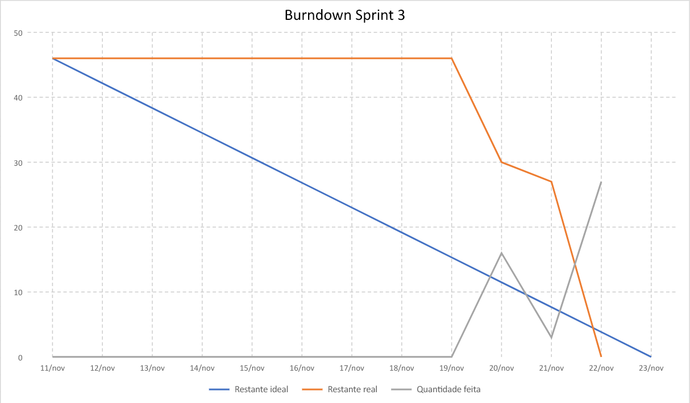

# Sprint 3

**Período:** 11/11/2026 a 23/11/2026

## 🎯 Objetivo da Sprint

Concluir o Green-Byte com foco na área administrativa, configuração do monitoramento, autenticação, responsividade, qualidade e documentação final. Durante a sprint, o escopo também foi ampliado com a gestão de usuários, auditoria administrativa e acompanhamento da saúde da coleta.

---

## Backlog Sprint 3 — Administração, configuração e qualidade final

> Objetivo: finalizar os recursos administrativos e consolidar a aplicação para a entrega do projeto.

**Total planejado inicialmente: 33 pts**

**Itens adicionados durante a sprint: 13 pts**

**Total considerado: 46 pts**

| Issue | ID | Atividade | Pontos | Área |
|---:|---|---|:---:|---|
| [#24](https://github.com/KaimanByte/Green-Byte/issues/24) | GA-13 | Planejamento da Sprint 3 | 2 | Gestão |
| [#25](https://github.com/KaimanByte/Green-Byte/issues/25) | GA-14 | Sprint Review e Retrospectiva da Sprint 3 | 2 | Gestão |
| [#26](https://github.com/KaimanByte/Green-Byte/issues/26) | GA-15 | Fechamento e entrega da Sprint 3 | 2 | Gestão |
| [#67](https://github.com/KaimanByte/Green-Byte/issues/67) | FE-12 | Responsividade e desempenho | 3 | Frontend |
| [#70](https://github.com/KaimanByte/Green-Byte/issues/70) | AU-03 | Área de configuração do monitoramento | 5 | Frontend e Backend |
| [#71](https://github.com/KaimanByte/Green-Byte/issues/71) | AU-04 | Login e proteção no frontend | 3 | Frontend |
| [#75](https://github.com/KaimanByte/Green-Byte/issues/75) | UX-03 | Diretrizes de apresentação dos indicadores | 2 | Interface |
| [#77](https://github.com/KaimanByte/Green-Byte/issues/77) | UX-05 | Avaliação de usabilidade | 3 | Interface |
| [#78](https://github.com/KaimanByte/Green-Byte/issues/78) | UX-06 | Melhorias da avaliação | 3 | Interface |
| [#81](https://github.com/KaimanByte/Green-Byte/issues/81) | QA-03 | Revisão de tipagem e código limpo | 3 | Qualidade |
| [#82](https://github.com/KaimanByte/Green-Byte/issues/82) | QA-04 | Testes das regras da Sprint 3 | 3 | Qualidade |
| [#83](https://github.com/KaimanByte/Green-Byte/issues/83) | QA-05 | Conferência do README, comandos e links | 2 | Documentação |
| [#107](https://github.com/KaimanByte/Green-Byte/issues/107) | AU-06 | Gestão de usuários e papéis | 5 | Frontend e Backend |
| [#108](https://github.com/KaimanByte/Green-Byte/issues/108) | AU-07 | Auditoria de operações administrativas | 3 | Frontend e Backend |
| [#109](https://github.com/KaimanByte/Green-Byte/issues/109) | MO-01 | Saúde e configuração dinâmica da coleta | 5 | Backend |

As issues #107, #108 e #109 foram incluídas durante a sprint para complementar a administração e o monitoramento da aplicação.

---

## Sprint Burndown

O gráfico considera os 46 pontos do escopo revisado. A linha real permaneceu em 46 pontos até 19/11, caiu para 30 em 20/11, para 27 em 21/11 e chegou a zero em 22/11. O arquivo-fonte editável está disponível em [`sprint-3-burndown.xlsx`](./sprint-3-burndown.xlsx).

Assim como nas sprints anteriores, o burndown representa as atualizações registradas no acompanhamento do projeto e não necessariamente a data em que cada implementação começou.

---

## 🔄 Retrospectiva da Sprint 3

A Sprint 3 consolidou a etapa final do projeto. A equipe ampliou a área administrativa, tornou a configuração da coleta dinâmica, adicionou gestão de usuários e auditoria, e reforçou os testes e a documentação da aplicação.

Como ponto positivo, a integração entre frontend e backend permitiu que as configurações administrativas passassem a refletir no funcionamento do monitoramento. A revisão final também ajudou a reunir as instruções de execução e as referências do projeto.

O principal ponto de melhoria continua sendo a atualização frequente das issues. Parte das alterações de status ficou concentrada no final da sprint, o que reduz a precisão do burndown e dificulta acompanhar a evolução real durante o período.

---

## Ações para a entrega final

- Adicionar o vídeo da apresentação quando a edição estiver concluída.
- Registrar a Sprint Review e a retrospectiva nas respectivas issues.
- Criar a tag da versão entregue e concluir o fechamento administrativo da sprint.
